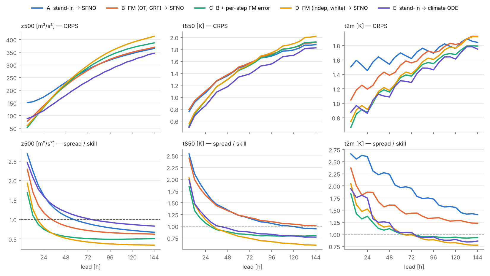

# Step 2: flow matching 앙상블 생성기 → 고정 SFNO 동역학장 — 설계·학습·평가

Step 1([step1_design.md](step1_design.md), [step1_results.md](step1_results.md))의 신경연산자 동역학장 G_θ 앞에
flow matching 앙상블 생성기를 붙여 **입력 → FM(앙상블 시나리오) → SFNO(물리 동역학) → 앙상블 예보** 구조를 만들고,
WeatherBench2 기준으로 Step 1 대역 앙상블과 climate ODE와 비교했다. 수치는 모두 이 클라우드 CPU 환경(4 thread)에서
WB2 ERA5 64×32에 돌린 결과(`runs/step2/`)를 옮긴 것이다. 전체 표는 [step2/wb2_tables.md](step2/wb2_tables.md),
원자료는 [step2/scores_2017.csv](step2/scores_2017.csv).

**후속**: 동역학장을 12000 it로 다시 학습한 라운드의 결과는 [step2_retrain_results.md](step2_retrain_results.md).

## 0. 요약

- **2단계 학습**: 1단계(Step 1)에서 SFNO가 동역학과 물리(PINN 힌지 + H¹ Sobolev)를 학습했고, 2단계에서는 그 가중치를
  고정한 채 flow matching이 **고정 연산자의 6 h 오차 분포** p(e | x₀)를 학습한다. 시나리오는 x₀ + κ·e⁽ᵐ⁾.
- **W2·Sobolev 구조**: 소스는 구면 Gaussian random field(오차의 차수 스펙트럼에 맞춤), 결합은 H^s 거리의 minibatch OT
  (W2 변위 보간 경로), 속도장은 neuraloperator SFNO, 손실은 구면조화 Sobolev 노름.
- **결과 (2017, 72 IC × 8멤버, 7변수 CRPS를 A 대비 비율로 평균)**:

  | | 24 h | 72 h | 144 h | 6–144 h 평균 |
  |---|---|---|---|---|
  | A 대역(Step 1) → SFNO | 1.000 | 1.000 | 1.000 | 1.000 |
  | B FM(OT, GRF) → SFNO | 0.938 | 0.994 | 1.012 | 0.977 |
  | **C FM(OT, GRF) → SFNO + 스텝별 FM 오차** | **0.836** | **0.986** | 1.019 | **0.941** |
  | D FM(독립, 백색잡음) → SFNO | 0.847 | 1.010 | 1.079 | 0.972 |
  | E 대역 → climate ODE (ResNet) | 0.754 | 0.883 | 0.971 | 0.866 |
  | SFNO 결정론 | 1.131 | 1.336 | 1.411 | 1.282 |

  SFNO를 쓰는 앙상블 중에서는 **FM 생성기를 IC와 매 스텝에 쓰는 C가 가장 좋다**(24 h z500 CRPS 134 vs 대역 174, t2m 0.87 vs 1.45 K).
  FM 시나리오(B, C, D)는 대역 앙상블보다 앙상블 평균 RMSE와 ACC도 좋다(24 h z500 RMSE 291–318 vs 405).
- **한계**: 144 h에서는 FM 이득이 사라지고, 고정 SFNO가 섭동을 수축시켜 C도 z500 spread/skill이 0.5 근처로 과소분산이다.
  climate ODE(ResNet) 앙상블 E가 모든 lead에서 가장 좋은데, 이는 생성기가 아니라 **동역학장 자체의 정확도 차이**(Step 1)다.
- **W2 구조의 효과**는 같은 κ에서 검증 CRPS로 보인다: κ = 4에서 OT+GRF 0.1480 vs 독립+백색 0.1529, κ = 8에서 0.1866 vs 0.2044.
  시나리오를 크게 키울수록 OT+GRF 시나리오가 덜 망가진다. 다만 각자 최적 κ에서의 차이(0.1480 vs 0.1484)는 작다.

리뷰(PR #2)에서 찾은 버그를 고친 뒤의 수치다: 처음 실행에서는 추론 때 FM 조건의 tisr 채널(알려진 강제력의 6 h 증분)이
0으로 들어가 학습 때와 달랐다. 고친 뒤 B, C, D를 2016에서 다시 보정하고 2017을 다시 채점했다. 선택된 κ는 같았고 점수는
0.5 % 안에서 바뀌었다(이전 결과는 `runs/step2/v1/`).

## 1. 설계

### 1.1 예측 구조

    x₀ (ERA5) ──► FM 생성기 g_φ(ε | x₀, Φ_θ(x₀) − x₀) ──► x₀⁽ᵐ⁾ = x₀ + κ·σ_e ⊙ z⁽ᵐ⁾   (m = 1..7, 0번은 x₀ 그대로)
              ──► 고정 SFNO 동역학장 G_θ (torchdiffeq midpoint, 6 h × 24) ──► 앙상블 예보 (144 h)

    C (확률적 동역학):  x_{k+1}⁽ᵐ⁾ = Φ_θ(x_k⁽ᵐ⁾) + κ_s·σ_e ⊙ z_k⁽ᵐ⁾,   z_k⁽ᵐ⁾ ~ g_φ(· | x_k⁽ᵐ⁾)

### 1.2 FM이 배우는 것: 고정 연산자의 오차 분포

학습 표적은 e = x₆ₕ(ERA5) − Φ_θ(x₀), 곧 Step 1 연산자가 한 스텝에서 틀리는 양이다. 채널별 RMS σ_e로 나눈 z = e/σ_e의
조건부 분포 p(z | x₀, Φ_θ(x₀) − x₀, 시각)를 conditional flow matching으로 학습한다. 조건에 연산자 자신의 증분을 넣었으므로
생성기는 "이 상태에서 이 연산자가 어느 방향으로 불확실한가"를 배우고, 시나리오가 연산자의 동역학에 맞춰진다(접목).
Step 1 대역은 상태와 무관한 무작위 6 h 분석 증분이었다.

측정값(학습 연도 256 창): z500의 σ_e는 6 h 변화량 std의 0.44배, 오차의 차수 스펙트럼은 (1 + l(l+1))^−0.48로
작은 규모까지 에너지가 있는 거친 장이다.

### 1.3 W2·Sobolev 구조 (`ffc/flow.py`)

| 요소 | 구현 | 가져온 것 |
|---|---|---|
| 소스 | 구면 GRF: 구면조화 계수를 채널·차수별 분산(표적 스펙트럼, `matched`)으로 뽑아 역 SHT, 점 분산 1로 정규화. `sobolev`(멱법칙 (1+l(l+1))^−s), `white`도 지원 | torch-harmonics `InverseRealSHT` |
| 결합 | 배치 안 소스·표적 사이 **제곱 H^s 거리**(가중 구면조화 계수의 유클리드 거리)로 exact EMD → 순열. 직선 경로 z_τ = (1−τ)ε + τz가 두 경험측도 사이 W2 변위 보간이 된다 | torchcfm `OTPlanSampler` |
| 경로·표적 속도 | u = z − ε (σ = 0) | torchcfm `ConditionalFlowMatcher`와 같은 식 |
| 속도장 | SFNO(width 64, 4 블록, l < 16) 입력 = z_τ, x₀, 연산자 증분, 위치·지형 7, 시각 4, τ 특징 8 → 66채널(tisr 제외) | neuraloperator `SFNO` (`ffc.field.make_backbone`) |
| 손실 | ‖v − u‖²_{H^s}, s = 0(면적가중 L2), s = −1이면 W2 접공간 노름 | `ffc.sobolev.SphericalSobolev` |
| 샘플러 | Heun 4 스텝(NFE 8) | pg-flow `pgcfm.cfm.heun` |

조건부 FM에 배치 OT를 쓰면 소스가 조건과 약하게 상관될 수 있다(배치 16, 차원 13만이라 순열은 대부분 항등에 가깝다).
그래서 효과는 같은 κ의 대조군(D)으로 따로 쟀다.

### 1.4 시나리오 크기 보정 (`scripts/calibrate_ensemble.py`)

κ(FM), α(대역), κ_s(확률적)는 **2016 검증 연도**의 00 UTC IC 16개, 8멤버로 고르고 2017은 쓰지 않는다. 기준은 z500·t850·t2m·u850의
24/72/144 h fair CRPS 평균(정규화 단위)이다. spread/skill만 맞추면 평균 오차를 무시하므로 proper score로 골랐다.

| 생성기 | 후보 → 선택 | 검증 CRPS | z500 SSR 24/72/144 h |
|---|---|---|---|
| A 대역 → SFNO | α 0.5, 1, 2, 4, 8 → **4** | 0.1488 | 1.61 / 0.90 / 0.66 |
| B FM(OT, GRF) | κ 1, 2, 4, 8, 16 → **4** | 0.1480 | 1.12 / 0.71 / 0.62 |
| D FM(독립, 백색) | κ 1, 2, 4, 8, 16 → **2** | 0.1484 | 0.76 / 0.41 / 0.34 |
| C 확률적 (κ ∈ {2, 4}) | κ_s 0.25, 0.5, 1, 2 → **κ 2, κ_s 0.5** | **0.1439** | 0.71 / 0.50 / 0.51 |
| E 대역 → climate ODE | α 0.5, 1, 2, 4 → **2** | 0.1294 | 1.59 / 1.02 / 0.81 |

## 2. 학습

| | 값 |
|---|---|
| 데이터 | WB2 ERA5 5.625° 64×32 6 h, pg-flow KAI 67채널 (`scripts/fetch_era5.sh`), 학습 2010–2015, 검증 2016, 시험 2017 |
| 고정 연산자 | Step 1 `sfno_h1_pinn` (593,026 파라미터, requires_grad off) |
| 생성기 | `ErrorFlow` 610,946 파라미터, 4000 it × batch 16, AdamW 3e-4 cosine, 2 thread |
| 시간 | fm_ot_matched 49분, fm_indep_white 46분 (동시 실행) |

검증 FM 손실(고정 노이즈)은 두 arm 모두 4000 it까지 단조 감소했다(250 it → 4000 it: OT+GRF 1.652 → 1.357, 독립+백색 1.248 → 1.087).
소스가 다르면 손실 크기가 달라서 두 값은 서로 비교하지 않는다.

## 3. WeatherBench2 (2017, 72 IC: 00 UTC, 5일 간격, 6 h 리드 144 h까지, 8멤버)

ACC 기후값은 2010–2015 일·시각 평균(±15일 평활). z500은 지오퍼텐셜(m²/s²).



### CRPS (24 / 72 / 144 h)

| model | z500 | t850 | t2m | u850 | msl |
|---|---|---|---|---|---|
| A 대역 → SFNO | 174 / 282 / **365** | 1.07 / 1.55 / **1.88** | 1.45 / 1.62 / 1.84 | 1.88 / **2.62** / 2.99 | 192 / 287 / **350** |
| B FM(OT, GRF) → SFNO | 140 / **279** / 369 | 1.10 / 1.58 / 1.92 | 1.20 / 1.56 / 1.93 | 1.96 / 2.63 / **2.98** | 159 / **284** / 355 |
| C B + 스텝별 FM 오차 | **134** / 289 / 387 | **0.94 / 1.53** / 1.93 | **0.87 / 1.38 / 1.79** | **1.75** / 2.63 / 3.02 | **153** / 295 / 370 |
| D FM(독립, 백색) → SFNO | 136 / 299 / 413 | 0.95 / 1.55 / 2.02 | 0.92 / 1.41 / 1.92 | 1.75 / 2.67 / 3.16 | 155 / 302 / 390 |
| E 대역 → climate ODE | 120 / 236 / 346 | 0.86 / 1.39 / 1.83 | 0.86 / 1.29 / 1.75 | 1.45 / 2.36 / 2.88 | 144 / 251 / 335 |
| persistence (MAE) | 336 / 557 / 632 | 1.72 / 2.64 / 2.92 | 1.00 / 1.52 / 1.71 | 3.17 / 4.56 / 4.93 | 335 / 523 / 574 |

굵게: SFNO를 쓰는 arm(A–D) 중 최저.

### 앙상블 평균 RMSE · ACC (z500, 24 / 72 / 144 h)

| model | RMSE | ACC |
|---|---|---|
| A 대역 → SFNO | 405 / 646 / 788 | 0.860 / 0.597 / 0.302 |
| B FM(OT, GRF) → SFNO | 318 / 607 / 783 | 0.916 / 0.658 / 0.334 |
| C B + 스텝별 FM 오차 | 291 / 594 / 795 | 0.930 / 0.678 / 0.339 |
| D FM(독립, 백색) → SFNO | 295 / 588 / 788 | 0.928 / 0.679 / 0.333 |
| SFNO 결정론 | 285 / 586 / 796 | 0.933 / 0.681 / 0.324 |
| E 대역 → climate ODE | 269 / 539 / 766 | 0.940 / 0.740 / 0.411 |
| climate ODE 결정론 | 220 / 520 / 839 | 0.961 / 0.776 / 0.410 |

### spread / skill (z500 · t850, 24 / 72 / 144 h)

| model | z500 | t850 |
|---|---|---|
| A 대역 → SFNO | 1.61 / 0.89 / 0.67 | 1.73 / 1.17 / 0.95 |
| B FM(OT, GRF) → SFNO | 1.17 / 0.72 / 0.62 | 1.66 / 1.18 / 1.01 |
| C B + 스텝별 FM 오차 | 0.75 / 0.51 / 0.51 | 1.07 / 0.82 / 0.80 |
| D FM(독립, 백색) → SFNO | 0.79 / 0.42 / 0.34 | 1.14 / 0.74 / 0.60 |
| E 대역 → climate ODE | 1.59 / 1.02 / 0.83 | 1.20 / 0.88 / 0.77 |

## 4. 읽은 것

1. **FM 시나리오는 대역보다 "맞는 방향"의 섭동이다.** 같은 고정 SFNO에 같은 크기 기준으로 보정했는데, B는 대역 A보다
   앙상블 평균이 훨씬 정확하고(24 h z500 RMSE 318 vs 405, t2m 2.60 vs 3.29 K) ACC도 높다. 대역은 상태와 무관한 증분이라
   평균을 끌고 가지만, FM은 이 상태에서 연산자가 실제로 틀리는 방향을 뽑는다. 특히 t2m에서 차이가 크다
   (대역은 지표 일주기와 맞지 않는 증분을 섞는다).
2. **IC만 섭동하면 SFNO가 수축시킨다.** 모든 SFNO arm에서 spread/skill이 6 h에 1.7–2.7로 과분산이었다가 lead와 함께
   0.3–0.7로 떨어진다(그림 아래 줄). Step 1에서 본 섭동 수축 그대로다. 그래서 IC 섭동을 키우면(κ) 초반 과분산 비용이
   커져 보정이 κ = 4에서 멈춘다.
3. **스텝마다 FM 오차를 넣으면(C) spread가 lead 내내 유지된다**(z500 SSR 0.75 → 0.51에서 평평, t850 0.8 근처).
   0–72 h CRPS가 SFNO arm 중 가장 좋고 6–144 h 평균으로도 A 대비 −5.9 %다. 144 h에서 A/B보다 조금 나쁜 것은
   C의 z500 bias(−45 m²/s², SFNO 결정론 −72)와 과소분산이 같이 남기 때문이다. κ_s를 키우면 spread는 늘지만 검증 CRPS가
   나빠졌다(κ_s 1: 0.1466, 2: 0.1845). 오차 표본이 연산자의 평균 편향을 담지 못하는 것이 다음 개선점이다(아래 6절).
4. **W2·GRF vs 독립·백색(B vs D)**: 같은 κ에서 OT+GRF가 검증 CRPS가 낮고(κ 4: 0.1480 vs 0.1529), κ가 클수록 차이가 커진다.
   백색 소스는 같은 κ에서 더 큰 초기 spread를 내지만 그만큼 빨리 사라진다(시험 z500 SSR D 0.79 → 0.34, B 1.17 → 0.62):
   격자 규모의 잡음 성분이 SFNO에서 곧바로 감쇠하기 때문으로 읽는다. 결과적으로 D는 24 h에 좋고 144 h에 가장 나쁘다
   (z500 CRPS 413). OT 결합 자체의 효과와 GRF 소스의 효과는 이 실험에서 분리하지 않았다.
5. **동역학장의 정확도가 상한이다.** climate ODE(ResNet) 대역 앙상블 E가 모든 lead에서 가장 좋다. 같은 FM 생성기를 ResNet
   동역학장에 붙이면(그 연산자의 오차로 다시 학습) 더 나을 것으로 보이며, 코드는 `--field-tag climate_ode`로 그대로 돈다.

## 5. 재현

```bash
bash scripts/fetch_era5.sh                     # ERA5 64x32 2010-2017 (~1 분/년)
KAI=data/era5_5p625/kai6h STEP1=runs/step1 OUT=runs/step2 bash scripts/run_step2.sh
python scripts/plot_step2.py --scores runs/step2/eval_2017/scores.csv --out docs/step2/fig_crps_ssr.png
```

설정은 [configs/step2_64x32.yaml](../configs/step2_64x32.yaml). 8멤버 × 25 lead × 67채널 예보 파일은 64×32에서도 개당
5.9 GB라, 디스크가 30 GB인 환경에서는 예보 → 채점 → 삭제 순서로 돌렸다. `scripts/evaluate.py`는 헤드라인 채널만 읽는다.

## 6. 다음 단계

- **편향 항**: 고정 SFNO의 오차는 평균이 0이 아니다(144 h z500 bias −72). FM 표적에서 조건부 평균을 따로 회귀하거나
  (pg-flow step 13의 "평균은 회귀, 구조는 FM"), 스텝별 보정을 결정론 항으로 넣는다.
- **ResNet 동역학장 + FM**: 동역학장이 정확한 쪽(E의 기반)에 같은 생성기를 학습한다.
- **소스·결합 분리 실험**: OT + 백색, 독립 + GRF arm으로 W2 결합과 Sobolev 소스의 몫을 나눈다.
- **GPU·1.5°**: 같은 코드가 `--device cuda`로 돈다. 생성기 학습량(4000 it × 16)이 CPU 예산이라 FM 분포의 표현력은 제한적이다.
