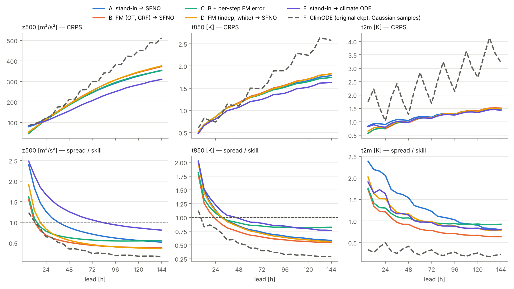

# Step 2 개선 1차: 학습량 확대 (동역학장 12000 it + FM 재접목) — 결과

[step2_flow_ensemble.md](step2_flow_ensemble.md)의 결론은 "동역학장의 정확도가 상한"이었고, Step 1 학습 곡선은 3000 it에서 아직
내려가고 있었다. 그래서 첫 개선으로 동역학장 두 개(SFNO H¹+PINN, climate ODE ResNet)를 **4배 긴 학습(12000 it)과 72 h까지의
롤아웃 커리큘럼**으로 다시 학습하고, 새 SFNO의 오차로 FM 생성기를 다시 학습해 접목했다(`scripts/run_step2.sh`,
`FIELD=sfno_h1_pinn_long CLIMODE=climate_ode_long`). 절차·arm·평가는 Step 2와 같다. 전체 표는
[step2/wb2_tables_long.md](step2/wb2_tables_long.md), 원자료 [step2/scores_2017_long.csv](step2/scores_2017_long.csv).

## 0. 요약

- **동역학장이 크게 좋아졌다.** 2017 결정론 z500 RMSE 24/72/144 h: SFNO 285/586/796 → **237/508/746** m, climate ODE 220/520/839 →
  **184/425/722** m. SFNO의 PINN 잔차도 72 h 롤아웃에서 ERA5 수준이다(u 1.15, v 1.22, T 0.97, 질량 0.92, 정수 1.00 × ERA5).
- **앙상블도 모두 좋아졌다.** 이전 라운드의 대역 앙상블 A를 1로 둔 7변수 CRPS(6–144 h 평균): A 0.870, B 0.866, **C 0.840**, D 0.866,
  E 0.781. 즉 같은 설계에서 학습량만 늘려 13–16 % 개선.
- **생성기 효과는 유지되지만 폭이 줄었다.** 새 라운드 안에서 A 대비 C 0.962(이전 0.941), B 0.989(0.977), D 0.992(0.972).
  연산자가 정확해지면 오차 σ_e가 작아지고(z500 0.44 → 0.38 × 6 h 변화량) 대역 섭동(α 2)도 덜 망가뜨려, FM이 "맞는 방향"으로
  얻는 몫이 줄어든다. 반면 FM 시나리오의 **앙상블 평균 정확도 이득은 그대로**다(24 h z500 RMSE: 대역 279 vs FM 244–248,
  t2m CRPS 0.90 vs 0.74).
- **스텝별 FM 오차(C)는 여전히 SFNO 앙상블 중 최선**이고 72–144 h에서 유일하게 spread를 유지한다(z500 SSR 144 h: A 0.52, B 0.38,
  C 0.56, D 0.36). IC만 섭동하는 B·D는 더 정확해진 SFNO가 더 강하게 수축시켜 144 h에서 A보다 나쁘다.
- **climate ODE(ResNet) 앙상블 E는 더 앞서 갔다**(A 대비 0.902, 이전 0.866 → 격차 유지). 결정론에서도 ResNet의 개선 폭이 더 컸다
  (24 h 220 → 184 vs SFNO 285 → 237).

- **원본 ClimODE(공개 체크포인트, arm F)도 같은 72 IC에서 돌렸다(4절).** 결정론 z500 RMSE 205 / 497 / 875, t850 1.34 / 2.49 / 4.19,
  t2m 2.28 / 3.07 / 5.44. 24 h의 z500·t850은 우리 재학습 climate ODE와 비슷하거나 낫지만(t850 1.34 vs 1.53), 72 h 이후와 t2m(00 UTC
  IC에서 일주기 편향)은 크게 뒤지고, Gaussian 불확실성의 spread가 너무 작아(z500 SSR 0.65 → 0.17) 3변수 CRPS(A = 1)는 1.48로 모든
  우리 앙상블(E 0.92, C 0.97)보다 나쁘다.

## 1. 동역학장 재학습

| | Step 1 (3000 it, K 8) | 이번 (12000 it, K 12) |
|---|---|---|
| 커리큘럼 | 1 → 2 → 4 → 8 스텝 | 1 → 2 → 4 → 8 → 12 스텝 (72 h) |
| 선택된 it | 3000 / 2750 | 11500 / 11500 |
| 학습 시간 (CPU 2 thread) | 20 분* / 66 분 | 281 분 / 208 분 |
| 검증 2016 z500 RMSE 6 … 48 h, SFNO | 101 / 175 / 235 / 286 / 331 / 375 / 414 / 452 | **88 / 151 / 200 / 243 / 283 / 322 / 359 / 395** |
| 검증 2016 z500 RMSE 6 … 48 h, climate ODE | 93 / 139 / 191 / 231 / 273 / 306 / 344 / 375 | **82 / 121 / 155 / 189 / 224 / 258 / 288 / 319** |

\* Step 1 SFNO의 기록된 시간은 재개 후 구간만이다. 두 arm 모두 12000 it까지 검증 손실이 내려갔고(SFNO 11500 it 최저), 아직
수렴했다고 보기 어렵다. 학습량이 여전히 부족하고, GPU가 있으면 같은 명령으로 더 긴 학습과 1.5° 자료가 가능하다.

### WB2 2017 결정론 (72 IC, 24 / 72 / 144 h)

| model | z500 RMSE | z500 ACC | t850 RMSE | t2m RMSE | msl RMSE |
|---|---|---|---|---|---|
| SFNO (Step 1) | 285 / 586 / 796 | 0.933 / 0.681 / 0.324 | 1.86 / 3.00 / 3.83 | 1.58 / 2.75 / 3.75 | 323 / 581 / 726 |
| **SFNO (12000 it)** | **237 / 508 / 746** | **0.954 / 0.768 / 0.432** | 1.64 / 2.69 / 3.60 | 1.40 / 2.29 / 2.98 | 273 / 491 / 668 |
| climate ODE (Step 1) | 220 / 520 / 839 | 0.961 / 0.776 / 0.410 | 1.67 / 2.71 / 3.79 | 1.58 / 2.69 / 3.74 | 262 / 532 / 774 |
| **climate ODE (12000 it)** | **184 / 425 / 722** | **0.972 / 0.847 / 0.533** | 1.50 / 2.44 / 3.46 | 1.51 / 2.36 / 3.11 | 227 / 433 / 652 |

(t850·t2m·msl의 Step 1 값은 [step1_results.md](step1_results.md), 새 값은 [step2/wb2_tables_long.md](step2/wb2_tables_long.md).)

## 2. FM 재학습과 보정 (2016)

새 SFNO의 6 h 오차는 z500에서 6 h 변화량 std의 0.38배(이전 0.44), 스펙트럼 (1 + l(l+1))^−0.46(이전 −0.48). 생성기 구조·예산은 같다
(610,946 파라미터, 4000 it × 16, 51 / 48 분).

| 생성기 | 후보 → 선택 | 검증 CRPS (이전 라운드) | z500 SSR 24/72/144 h |
|---|---|---|---|
| A 대역 → SFNO | α 0.5, 1, 2, 4, 8 → **2** (이전 4) | 0.1317 (0.1488) | 1.06 / 0.56 / 0.41 |
| B FM(OT, GRF) | κ 1, 2, 4, 8, 16 → **2** (이전 4) | 0.1305 (0.1480) | 0.68 / 0.45 / 0.39 |
| D FM(독립, 백색) | κ 1, 2, 4, 8, 16 → **2** (2) | 0.1301 (0.1484) | — |
| C 확률적 (κ ∈ {1, 2}) | κ_s 0.25 … 2 → **κ 2, κ_s 0.5** (같음) | **0.1264** (0.1439) | 0.76 / 0.58 / 0.57 |
| E 대역 → climate ODE | α 0.5, 1, 2, 4 → **2** (2) | 0.1175 (0.1294) | — |

연산자가 정확해지자 보정된 시나리오 크기가 절반으로 줄었다(α, κ 4 → 2). 같은 κ에서 OT+GRF와 독립+백색의 차이는 κ 2에서는 없고
(0.1305 vs 0.1301) κ 4에서 0.1309 vs 0.1343, κ 8에서 0.1674 vs 0.1808로 κ가 클수록 벌어지는 패턴은 그대로다.

## 3. WB2 2017 앙상블 (72 IC, 8멤버)



### 7변수 CRPS 비율 (A = 1, 같은 라운드 안)

| | 24 h | 72 h | 144 h | 6–144 h 평균 | (이전 라운드) |
|---|---|---|---|---|---|
| A 대역 → SFNO | 1.000 | 1.000 | 1.000 | 1.000 | 1.000 |
| B FM(OT, GRF) → SFNO | 0.955 | 1.005 | 1.022 | 0.989 | 0.977 |
| **C B + 스텝별 FM 오차** | **0.952** | **0.977** | **0.970** | **0.962** | 0.941 |
| D FM(독립, 백색) → SFNO | 0.963 | 0.998 | 1.020 | 0.992 | 0.972 |
| E 대역 → climate ODE | 0.892 | 0.886 | 0.916 | 0.902 | 0.866 |
| SFNO 결정론 | 1.285 | 1.321 | 1.338 | 1.305 | 1.282 |

### CRPS (24 / 72 / 144 h; 굵게 = SFNO arm 중 최저)

| model | z500 | t850 | t2m | u850 | msl |
|---|---|---|---|---|---|
| A 대역 → SFNO | 118 / **244** / 354 | **0.86 / 1.38** / 1.79 | 0.90 / 1.17 / **1.46** | 1.60 / 2.51 / 2.98 | 138 / **253** / 334 |
| B FM(OT, GRF) → SFNO | 113 / 255 / 372 | **0.86** / 1.40 / 1.83 | **0.74 / 1.14** / 1.51 | **1.57** / 2.45 / 2.94 | 132 / 264 / 354 |
| C B + 스텝별 FM 오차 | **111** / 246 / **353** | **0.86 / 1.36 / 1.74** | 0.76 / 1.15 / **1.46** | **1.57 / 2.38 / 2.80** | **129** / 254 / **332** |
| D FM(독립, 백색) → SFNO | 114 / 254 / 376 | **0.86** / 1.38 / 1.83 | 0.78 / 1.14 / 1.49 | 1.58 / 2.44 / 2.94 | 132 / 262 / 355 |
| E 대역 → climate ODE | 107 / 206 / 310 | 0.81 / 1.25 / 1.63 | 0.79 / 1.13 / 1.43 | 1.35 / 2.15 / 2.71 | 129 / 220 / 300 |

### 앙상블 평균 RMSE · ACC · spread/skill (z500, 24 / 72 / 144 h)

| model | RMSE | ACC | SSR z500 | SSR t850 |
|---|---|---|---|---|
| A 대역 → SFNO | 279 / 534 / 730 | 0.935 / 0.739 / 0.428 | 1.26 / 0.71 / 0.52 | 1.13 / 0.73 / 0.58 |
| B FM(OT, GRF) → SFNO | 244 / 513 / 732 | 0.951 / 0.763 / 0.442 | 0.69 / 0.44 / 0.38 | 0.97 / 0.65 / 0.54 |
| C B + 스텝별 FM 오차 | 245 / 521 / 751 | 0.951 / 0.760 / 0.430 | 0.79 / 0.57 / 0.56 | 1.08 / 0.84 / 0.82 |
| D FM(독립, 백색) → SFNO | 248 / 513 / 738 | 0.949 / 0.764 / 0.435 | 0.84 / 0.46 / 0.36 | 1.11 / 0.71 / 0.56 |
| E 대역 → climate ODE | 245 / 480 / 692 | 0.951 / 0.794 / 0.508 | 1.67 / 1.06 / 0.81 | 1.23 / 0.89 / 0.77 |
| SFNO 결정론 | 237 / 508 / 746 | 0.954 / 0.768 / 0.432 | | |
| climate ODE 결정론 | 184 / 425 / 722 | 0.972 / 0.847 / 0.533 | | |

## 4. 읽은 것

1. **학습량이 가장 큰 병목이었다.** 설계를 바꾸지 않고 학습만 4배 늘려 결정론 RMSE가 10–20 %, 앙상블 CRPS가 13–16 % 좋아졌고
   아직 수렴 전이다. GPU에서 같은 코드로 더 긴 학습·1.5° 자료를 돌리는 것이 다음 라운드의 가장 확실한 이득이다.
2. **SFNO의 섭동 수축은 더 심해졌다.** B의 z500 SSR 24 h가 1.17 → 0.69로 떨어졌다(같은 설계, κ만 4 → 2). 정확한 연산자일수록
   IC 섭동을 빨리 지우므로, 앙상블 spread는 **롤아웃 안에서** 공급해야 한다. C가 그 역할을 하고, 이제 SFNO arm 중 72 h와 144 h
   모두에서 가장 좋다. 하지만 C의 SSR도 0.56이라 κ_s를 키울 여지가 있어 보이는데 검증 CRPS는 κ_s 1에서 나빠졌다(0.1298 vs 0.1264):
   스텝 오차 표본의 **크기**가 아니라 **구조**(연산자의 평균 편향 −60 m²/s² at 144 h, 시간 상관)가 부족하다.
3. **E와의 격차는 생성기가 아니라 장의 문제다.** 두 장 모두 좋아졌고 ResNet이 더 많이 좋아졌다. 다음 라운드에서는 (a) FM 생성기를
   ResNet 장에 접목한 "E + FM", (b) SFNO의 편향 항(조건부 평균 회귀)을 FM 표적에서 분리, (c) 별도 스레드에서 진행 중인 SpeedyWeather
   물리 코어 + 학습 잔차 구조를 붙이는 순으로 본다.

## 5. 재현

```bash
# fields (12000 it, K 12)
python scripts/train_field.py --kai $KAI --out runs/step3 --tag sfno_h1_pinn_long --backbone sfno --width 64 --layers 4 --modes-lat 16 \
    --lambda-sob 1 --sob-s 1 --lambda-p 0.05 --phys-target 1 --iters 12000 --batch 4 --K 12 --curriculum 1 2 4 8 12 --val-K 12 --val-every 500
python scripts/train_field.py --kai $KAI --out runs/step3 --tag climate_ode_long --backbone resnet --width 48 --layers 2 \
    --iters 12000 --batch 4 --K 12 --curriculum 1 2 4 8 12 --val-K 12 --val-every 500
# flows, calibration, 2017 forecasts, WB2
KAI=$KAI STEP1=runs/step3 OUT=runs/step3 FIELD=sfno_h1_pinn_long CLIMODE=climate_ode_long bash scripts/run_step2.sh
```

가중치: `/mnt/project-files/step3/` (프로젝트 공유 폴더).

## 4. 원본 ClimODE 기준선 (arm F): 공개 체크포인트를 원저자 코드로

1–3절의 "climate ODE"는 ClimODE의 네트워크(`Climate_ResNet_2D`)만 가져와 우리 solver·손실·66채널 자료로 다시 학습한 것이다.
요청("원본 유지")에 따라 **ClimODE 원본**, 즉 원저자 코드(Aalto-QuML/ClimODE e729d23, pg-flow `third_party/climode`에 vendoring)와
공개 체크포인트 `ClimODE_global.pt`(2.75 M 파라미터)를 그대로 같은 72개 IC에서 144 h까지 돌려 같은 WB2 코드로 채점했다
(`scripts/run_climode_original.py`; 닫힌식 Gaussian CRPS는 [step2/crps_gauss_F_ClimODE_orig.json](step2/crps_gauss_F_ClimODE_orig.json)).

| 항목 | 원본 ClimODE (F) | 우리 arm (A–E) |
|---|---|---|
| 코드·가중치 | upstream 그대로: 자료 로더, IC별 속도장 적합(`Optim_velocity`, Gaussian kernel, Adam 200 step), 이류 PDE + ResNet·attention, 1 h Euler, Gaussian emission head | `ffc` |
| 자료 | 같은 WB2 5.625° zarr를 ClimODE 형식 5변수(z500, t850, t2m, u10, v10)로, 2006–2018 min-max 정규화 | KAI 67채널, 2010–2017 |
| 학습 기간 | 2006–2015 (원저자, 10년) | 2010–2015 (6년) |
| 평가 루프 | upstream `evaluation_global.py`와 같게: 2017·2018의 같은 시각을 한 배치(2)로, `model.eval()` 없이(batch norm이 그 배치 통계, dropout on) | — |
| IC | 우리와 같은 72개(2017, 00 UTC, 5일 간격); 첫 IC들의 과거 2프레임은 2016년 끝에서 | 같음 |
| 불확실성 | 격자점별 N(mean, std)에서 8개 독립 표본 → 다른 arm과 같은 fair CRPS·spread; 닫힌식 Gaussian CRPS와 일치 확인(z500 24 h 121.2 = 121.2) | 8멤버 |
| 비용 (CPU) | IC당 속도장 8 s + 적분 약 9분 → 72 IC를 2 프로세스로 5.4 h | — |

### WB2 2017 (72 IC, 24 / 72 / 144 h)

| model | z500 RMSE | z500 ACC | t850 RMSE | t2m RMSE | z500 편향 | t2m 편향 |
|---|---|---|---|---|---|---|
| **F 원본 ClimODE (mean)** | 205 / 497 / 875 | 0.966 / 0.799 / 0.410 | **1.34** / 2.49 / 4.19 | 2.28 / 3.07 / 5.44 | −9 / −46 / −92 | −0.44 / −0.83 / −2.31 |
| climate ODE (12000 it) | **184 / 425 / 722** | **0.972 / 0.847 / 0.533** | 1.53 / **2.37 / 3.34** | 1.51 / 2.36 / 3.11 | +2 / +8 / +17 | +0.24 / +0.43 / +0.50 |
| SFNO (12000 it) | 237 / 508 / 746 | 0.954 / 0.768 / 0.432 | 1.65 / 2.62 / 3.43 | **1.40 / 2.29 / 2.98** | −4 / −32 / −78 | −0.14 / −0.22 / −0.12 |
| ClimODE 논문 (12 UTC IC, 2017–18) | 193 / 479 / 784 | — | 1.55 / 2.58 / 3.62 | 1.40 / 2.75 / 3.30 | — | — |

| model (앙상블) | z500 CRPS | t850 CRPS | t2m CRPS | z500 SSR | 3변수 CRPS 비율 (A = 1) 24 / 72 / 144 / 평균 |
|---|---|---|---|---|---|
| A 대역 → SFNO | 118 / 244 / 354 | 0.86 / 1.38 / 1.79 | 0.90 / 1.17 / 1.46 | 1.26 / 0.71 / 0.52 | 1 / 1 / 1 / 1 |
| C FM + 스텝별 오차 → SFNO | 111 / 246 / 353 | 0.86 / 1.36 / 1.74 | 0.76 / 1.15 / 1.46 | 0.79 / 0.57 / 0.56 | 0.930 / 0.994 / 0.991 / 0.965 |
| E 대역 → climate ODE | **107 / 206 / 310** | 0.81 / **1.25 / 1.63** | 0.79 / **1.13 / 1.43** | 1.67 / 1.06 / 0.81 | **0.910 / 0.905 / 0.922 / 0.921** |
| **F 원본 ClimODE (Gaussian)** | 121 / 298 / 512 | **0.74** / 1.50 / 2.58 | 1.03 / 1.68 / 3.21 | 0.65 / 0.24 / 0.17 | 1.011 / 1.247 / 1.694 / 1.478 |

(전체 표 [step2/wb2_tables_long.md](step2/wb2_tables_long.md); 그림 [step2/fig_crps_ssr_long.png](step2/fig_crps_ssr_long.png)의 점선이 F.)

### 해석

- **24 h 이내에서는 원본 ClimODE가 강하다.** t850 24 h RMSE 1.34는 모든 arm 중 최저이고 z500 205도 논문 값(193)에 가깝다. 이류 PDE
  구조와 IC별 속도장 적합은 짧은 lead의 온도·지오포텐셜 이류를 잘 잡는다. 24 h t850 CRPS 0.74도 최저다.
- **72 h 이후는 감쇠한다.** z500 144 h 875(climate ODE 722, SFNO 746), 편향 −92 m²/s², t2m 편향 −2.3 K. Step 1의 SFNO와 같은
  "에너지 손실형" 장기 오차이고, 우리 재학습 ResNet은 10년이 아니라 6년 자료로 학습했는데도 z500의 모든 lead에서 더 정확하다.
- **t2m는 프로토콜 민감성이 크다.** 원본의 t2m RMSE가 lead 0 / 6 / 12 / 24 h에서 2.3 / 4.1 / 4.9 / 2.3 K로 일주기 패턴을 보인다.
  공개 체크포인트는 12 UTC IC(2일 간격)로 학습·평가되었고, 00 UTC IC에서는 emission head가 t2m에 큰 편향을 낸다. 같은 코드를 12 UTC
  IC로 돌린 pg-flow 11단계(1월 16개 IC)에서는 t2m 6 / 24 h 1.97 / 2.76이었다. 즉 F의 t2m은 ClimODE의 최선이 아니라 "원본을 우리
  프로토콜에 그대로 넣었을 때"의 값이며, z500·t850에는 이런 패턴이 없다.
- **Gaussian 불확실성은 과소산포다.** spread/skill이 24 h 0.65에서 144 h 0.17로 떨어져 3변수 CRPS는 72 h 1.25배, 144 h 1.69배(A 대비).
  반면 우리 앙상블은 E 0.92, C 0.97로 모두 F보다 낫고, 72 h 이후에는 결정론 SFNO·climate ODE의 MAE(1.33 / 1.26)보다도 F가 나쁘다.
  Step 2의 결론과 같다: 동역학장 위에 spread를 유지하는 생성기(또는 대역 섭동)를 두는 쪽이 격자점별 분산 head보다 보정에 유리하다.
- **한계.** u10·v10은 KAI 계약에 없어 공통 표에서 뺐고, ACC 기후값은 모든 arm에 같은 2010–2015 일·시각 기후값을 썼다. ClimODE를
  12 UTC IC로 다시 돌리거나(`--stride`와 IC 시각 변경) `--eval-mode`(batch norm running 통계)로 돌리는 변형은 비용(IC당 9분) 때문에
  하지 않았다.
