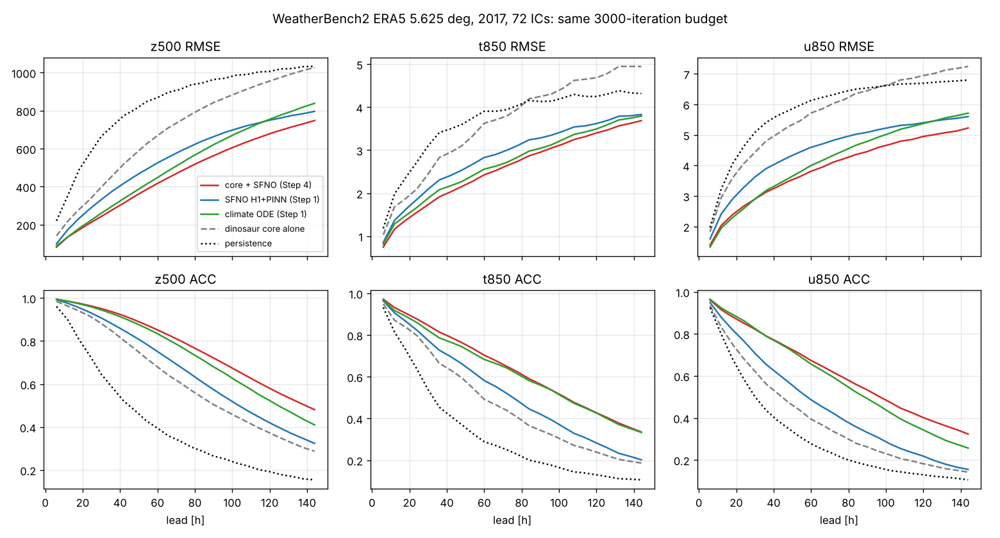

# Step 4: 구면 물리 코어를 neural operator의 보조 구조로 (SpeedyWeather 역할)

## 1. 질문과 설계

질문: SpeedyWeather.jl 같은 전 지구 spectral GCM을 "공간장을 이해하는 보조 구조"로 붙여 neural operator 학습을 강화할 수 있는가.

설계: 장(field)을 물리 코어와 학습 잔차로 나눈다.

    dx/dt = alpha ⊙ F_phys(x) + R_theta(x, F_phys(x), t)

* `F_phys(x)`: ERA5 상태 x에서 출발한 구면조화 원시방정식 코어의 6 h 증분. 이류, 코리올리 힘, 기압경도력, 정역학 균형, 중력파 전파를 T21 절단 안에서 정확히 계산한다.
* `R_theta`: Step 1의 SFNO(H1 + PINN 힌지)와 같은 구조. 입력에 코어 증분이 추가되고, 코어가 놓친 것(마찰, 복사, 지표, 습윤 과정, 코어 자체의 절단 오차)만 학습한다. 출력 헤드가 0으로 초기화되어 있어 학습 전에는 코어 그 자체다.
* `alpha` (66 채널): 학습 쌍 64개에서 최소제곱으로 맞춘 채널별 신뢰도, [0, 1]로 자른다. 코어가 기술하지 못하는 채널은 자동으로 꺼진다.
* 코어는 각 6 h 스텝의 시작 상태에서 한 번 계산하고 스텝 동안 고정된 강제로 쓴다(코어를 통한 역전파는 없음).

### 백엔드: SpeedyWeather.jl 대신 dinosaur

이 클라우드 환경은 Julia 배포 서버(julialang-s3.julialang.org, pkg.julialang.org)와 github.com 아카이브를 막고 있어 SpeedyWeather.jl을 설치할 수 없다. 그래서 같은 종류의 코어인 **dinosaur**(NeuralGCM의 JAX spectral dynamical core, 프로젝트 repo)를 썼다. 구면조화 + sigma 좌표 + IMEX RK3 + hyperdiffusion + 습윤 원시방정식으로 SpeedyWeather의 dynamical core와 같은 계열이다. 백엔드는 `ffc/physcore.py`의 `SpectralCore` 한 곳에만 있으므로, 같은 (B, 66, H, W) 정규화 6 h 증분을 돌려주는 SpeedyWeather 래퍼(juliacall)나 로컬 SpeedyWeather 실행에서 내보낸 tendency로 교체할 수 있다.

## 2. 코어 연결: 무엇이 중요했나

KAI 12개 기압면(50–1000 hPa), 5.625° 등각 격자 → 위도 선형 보간으로 T21 Gaussian 격자(경도 동일) → 기압면에서 sigma로(dinosaur `vertical_interpolation`) → spectral State → 6 h 적분 → sigma에서 기압면으로 → KAI 격자. 증분은 `P(core_6h(s0)) - P(s0)`로 계산해서 보간 왕복 오차와 x 자체의 T21 절단이 1차까지 상쇄된다.

2016년 16개 상태에서 코어 6 h 증분의 z500 RMSE (persistence 214 m):

| 설정 | z500 6 h RMSE | z500 상관 |
| --- | --- | --- |
| ERA5 sp 그대로, 12층 | 2319 m | 0.07 |
| sp를 코어의 (필터된) 지형 위에서 ERA5 z로 다시 계산 (`get_surface_pressure`) | 184 m | 0.68 |
| + 18층 | 177 m | 0.70 |
| + 6 h digital filter initialization | **139 m** | **0.78** |

ERA5의 sp는 실제 지형 위의 값이라 T21 지형과 어긋나고, 그 차이가 6 h에 25 hPa 수준의 조정을 일으킨다. 지형 정합과 DFI가 핵심이다. dinosaur의 `interp_sigma_to_pressure`는 지면 아래 기압면에서 NaN을 내므로 선형 외삽을 넘긴다. 최종 설정 T21, 18층, dt 30 분, DFI 6 h에서 4 CPU 기준 상태당 약 0.13 s다.

학습된 alpha는 물리적으로 해석된다(전체 값은 `runs/.../hybrid_sfno_h1_pinn.json`의 `core.alpha`):

* 자유대기 바람 u/v 300–600 hPa: 0.86–1.00, z 250–600 hPa: 0.78–0.82, t 400–600 hPa: 0.78–0.81. 코어를 거의 그대로 신뢰한다.
* 지표 근처 바람 u/v 1000 hPa: 0.06/0.10, 925 hPa: 0.16/0.26, t1000: 0.21. 코어에 경계층 마찰과 지표 플럭스가 없으니 꺼진다.
* 50–100 hPa: z/t/u/v 0.13–0.50, q 거의 0. 최상층 sigma 해상도의 한계다.
* t2m, tcwv, msl, skt: 0. 코어가 다루지 않는 채널이라 operator가 학습한다.

## 3. 실험

Step 1 `sfno_h1_pinn`과 같은 레시피와 예산(`scripts/run_step4.sh`): SFNO 폭 64, 4층, lmax 16, L2 + H1 Sobolev(λ 1) + PINN 힌지(λ 0.05, 목표 1), 3000 it × batch 4, K 1→2→4→8 커리큘럼, 학습 2010–15, 검증 2016, 테스트 2017. 학습 시간은 CPU 4코어에서 3.0 h였다(Step 1 SFNO는 약 1 h; 추가분은 코어 호출).

* `hybrid_sfno_h1_pinn`: 코어 + SFNO 잔차
* `core_only`: 같은 모델에서 헤드를 0으로 둔 것, 즉 alpha ⊙ 코어만 사용
* Step 1의 `sfno_h1_pinn`, `climate_ode`(ClimODE ResNet) 점수는 같은 IC, lead, 기후값, 채점기로 계산된 Step 1 캐시 점수다.

## 4. 결과: WeatherBench2 2017 (72 IC, 6–144 h)



RMSE (전체 표: [step4/wb2_tables.md](step4/wb2_tables.md))

| model | z500 24/72/144 h | t850 24/72/144 h | t2m 24/72/144 h | q700 24/72/144 h (g/kg) | u850 24/72/144 h | msl 24/72/144 h |
| --- | --- | --- | --- | --- | --- | --- |
| persistence | 577 / 912 / 1033 | 2.73 / 3.94 / 4.32 | 1.72 / 2.59 / 2.95 | 1.19 / 1.63 / 1.74 | 4.62 / 6.32 / 6.79 | 561 / 834 / 919 |
| core_only | 334 / 745 / 1030 | 2.10 / 3.79 / 4.94 | 1.72 / 2.59 / 2.95 | 1.04 / 1.73 / 2.15 | 4.06 / 6.03 / 7.24 | 561 / 834 / 919 |
| climate_ode (Step 1) | 220 / 520 / 839 | 1.67 / 2.71 / 3.79 | 1.58 / 2.69 / 3.74 | 0.85 / 1.24 / 1.51 | **2.59** / 4.33 / 5.71 | **262** / 532 / 774 |
| sfno_h1_pinn (Step 1) | 285 / 586 / 796 | 1.86 / 3.00 / 3.83 | 1.58 / 2.75 / 3.75 | 0.95 / 1.34 / **1.49** | 3.28 / 4.82 / 5.60 | 323 / 581 / **726** |
| **hybrid_sfno_h1_pinn** | **209 / 479 / 748** | **1.55 / 2.64 / 3.69** | **1.42 / 2.44 / 3.49** | **0.82 / 1.20 / 1.49** | 2.67 / **4.11 / 5.22** | 265 / **522** / 770 |

ACC z500 24/72/144 h: hybrid **0.964 / 0.802 / 0.481**, climate ODE 0.961 / 0.776 / 0.410, Step 1 SFNO 0.933 / 0.681 / 0.324, 코어 단독 0.915 / 0.607 / 0.288.

8멤버 stand-in 앙상블(IC 섭동, Step 1과 같은 방식):

| ensemble | z500 CRPS 24/72/144 h | t850 CRPS | z500 spread/skill 24/72/144 h |
| --- | --- | --- | --- |
| climate_ode_ens8 | 108 / 248 / **378** | 0.88 / 1.49 / **2.01** | **1.01 / 0.66 / 0.59** |
| sfno_h1_pinn_ens8 | 141 / 316 / 444 | 0.99 / 1.72 / 2.30 | 0.62 / 0.31 / 0.24 |
| **hybrid_sfno_h1_pinn_ens8** | **101 / 238** / 380 | **0.83 / 1.48** / 2.11 | 0.93 / 0.53 / 0.42 |

물리 진단(2016, 16 창, `scripts/diagnose_physics.py`, Step 1과 같은 설정; 1 = ERA5 수준):

| arm | R_u / R_v / R_T at 144 h | KE 비 24/72/144 h | 증분 진폭 비 24/72/144 h | z500 파워 l1-4 / l5-12 / l13-31 at 144 h |
| --- | --- | --- | --- | --- |
| climate_ode (Step 1) | 2.20 / 1.71 / 1.33 | 0.935 / 0.893 / 0.872 | 0.66 / 0.59 / 0.55 | 0.99 / 0.87 / 0.75 |
| sfno_h1_pinn (Step 1) | 1.74 / 1.86 / 1.22 | 0.861 / 0.770 / 0.719 | 0.51 / 0.43 / 0.40 | 1.02 / 0.56 / 0.29 |
| core_only | 2.03 / 1.97 / 1.70 | 0.955 / 0.919 / 0.870 | 0.39 / 0.32 / 0.27 | 1.05 / 1.27 / 0.76 |
| **hybrid_sfno_h1_pinn** | **1.48 / 1.31 / 1.05** | 0.911 / 0.859 / 0.823 | 0.64 / 0.55 / 0.50 | 1.02 / 0.80 / 0.55 |

## 5. 해석

1. **같은 학습량에서 hybrid가 Step 1 SFNO와 climate ODE를 모두 앞선다.** z500 RMSE는 Step 1 SFNO 대비 24 h −27 %, 72 h −18 %, 144 h −6 %이고, climate ODE 대비로는 −5 % / −8 % / −11 %다. t850, t2m, q700도 학습된 모델 중에서는 모든 lead에서 가장 낫다(t2m 144 h는 persistence 2.95가 여전히 낫다). 예외는 u850 24 h와 msl 24 h(climate ODE가 약간 낫다), msl 144 h(Step 1 SFNO가 낫다, 감쇠 효과)다.
2. **코어 혼자서는 약하다.** 코어 단독은 persistence보다는 낫지만 Step 1 SFNO보다 나쁘다(z500 24 h 334 m). 마찰, 복사, 습윤 과정이 없고 T21이며, 매 스텝 DFI가 진폭을 깎는다(증분 진폭 비 0.39 → 0.27). 개선은 둘의 결합에서 나온다. 코어는 대규모 역학(파동 전파, 균형)을 공짜로 주고, operator는 그 잔차만 배운다.
3. **"공간장 이해"가 진단에 보인다.** Step 1 SFNO의 약점이던 소규모 감쇠가 크게 줄었다. 144 h z500 파워는 l5–12 대역에서 0.56 → 0.80, l13–31에서 0.29 → 0.55이고, KE 비는 0.72 → 0.82다. 강형식 원시방정식 잔차도 144 h에서 모든 arm 중 가장 낮다(R_v 1.86 → 1.31, R_T 1.22 → 1.05). 코어가 공간 구조를 유지하고, 롤아웃 상태가 원시방정식 다양체 가까이에 머문다.
4. **앙상블: 분산이 살아난다.** Step 1/2의 핵심 문제였던 SFNO의 섭동 수축이 크게 완화됐다. z500 spread/skill은 0.62/0.31/0.24에서 0.93/0.53/0.42로 올랐다. 앙상블 CRPS는 24–72 h에서 climate ODE 앙상블보다 낫고 144 h에서는 비슷하다(z500 380 vs 378). 다만 여전히 under-dispersive이므로 Step 2 flow-matching 생성기를 이 hybrid 장 위에 다시 붙이면 같은 이득이 앙상블로 이어질 것으로 기대한다.

## 6. 한계와 다음 단계

* Step 3(12000 it) 장과는 아직 비교하지 않았다. 여기의 비교는 같은 3000 it 예산이다.
* 코어 비용 때문에 학습 시간이 Step 1 SFNO의 약 3배다(K 8 단계 6.9 s/it). DFI 6 h가 비용의 1/3이다.
* 다음 후보: (a) Step 2 FM 오차 생성기를 hybrid 장에 붙여 재보정, (b) 학습량 확대(12000 it), (c) 코어에 Held–Suarez식 마찰/복사 강제를 넣어 지표 근처 alpha 올리기, (d) Julia가 허용된 환경에서 SpeedyWeather.jl 백엔드(PrimitiveWetModel, 물리 파라미터화 포함)로 교체해 같은 프로토콜로 비교.

## 7. 재현

```bash
pip install -r requirements.txt     # jax[cpu], dinosaur 포함
python -m pytest tests -q            # tests/test_step4.py: 정지 대기 보존, jet 회전, hybrid = 코어(초기)
KAI=data/era5_5p625/kai6h STEP1=runs/step1 OUT=runs/step4 bash scripts/run_step4.sh
python scripts/diagnose_physics.py --kai data/era5_5p625/kai6h --run runs/step4 --tags hybrid_sfno_h1_pinn core_only
python scripts/plot_step4.py runs/step4/eval_2017/scores.csv docs/step4/fig_rmse_acc.png
```

가중치와 점수: 프로젝트 공유 폴더 `step4/`.
