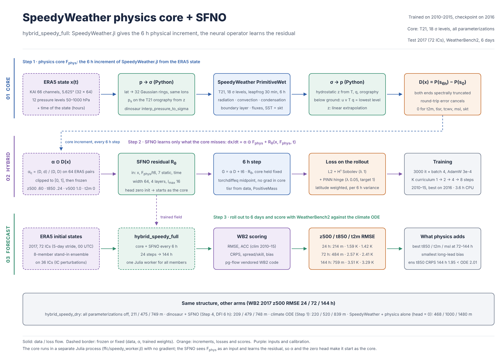
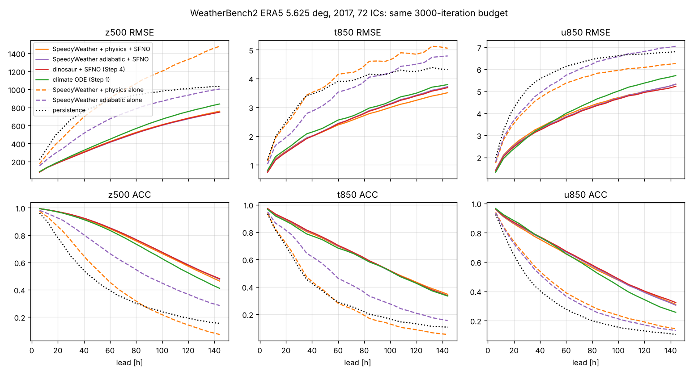

# Step 5: SpeedyWeather.jl을 물리 코어로 (Step 4 백엔드 교체)

## 1. 무엇을 했나

Step 4의 hybrid 장 `dx/dt = alpha ⊙ F_phys(x) + R_theta(x, F_phys(x), t)`에서 F_phys를 dinosaur(JAX) 대신 **SpeedyWeather.jl**로 바꿨다. 나머지(SFNO H1 + PINN 잔차, 3000 it, 학습 2010–15 / 검증 2016 / 테스트 2017, WB2 채점)는 Step 4와 똑같다.

* `ffc/speedycore.py` `SpeedyCore`: `SpectralCore`(dinosaur)와 같은 계약. 정규화된 KAI 상태 (B, 66, H, W)를 받아 6 h 증분 `P(core_6h(s0)) - P(s0)`를 돌려준다. 물리 과정이 태양 천정각을 쓰므로 `increment(x, hours)`로 상태의 시각을 함께 받는다.
* `ffc/speedy_worker.jl`: SpeedyWeather `PrimitiveWetModel`을 T21 full Gaussian 격자(32 × 64, KAI 경도와 동일), 등간격 sigma 18층, leapfrog dt 30분으로 돌리는 Julia 프로세스. torch와 같은 프로세스에 Julia 런타임을 넣지 않으려고 별도 프로세스로 띄우고 /dev/shm 파일과 줄 단위 명령으로 주고받는다. 매 상태는 초기화 시점의 경계 상태에서 출발하고, 해수면 온도와 지면 온도는 그 상태의 ERA5 skt로 둔다. 그래서 호출끼리 서로 독립이다.
* KAI ↔ sigma 매핑은 Python에 두고 dinosaur의 `vertical_interpolation`을 그대로 재사용한다. 두 백엔드가 같은 매핑을 보므로 차이는 코어에서만 나온다. 지표기압은 SpeedyWeather 자체 T21 지형 위에서 ERA5 z 프로파일로 다시 계산한다(Step 4에서 가장 중요했던 설정).
* `FieldConfig.core = "speedy"`, `train_field.py --core speedy --core-physics all|none|<끌 과정 목록>`, `scripts/validate_core.py`(코어 단독 6 h 증분 검증), `scripts/run_step5.sh`, `scripts/plot_step5.py`, `tests/test_step5.py`.

### 설치: Julia 서버가 막힌 환경에서

julialang-s3 / pkg.julialang.org / install.julialang.org와 github.com HTTP 다운로드는 여전히 403이다. conda-forge와 github git은 열려 있어서 `scripts/install_speedyweather.sh`로 해결했다.

1. Julia 1.12는 conda-forge에서 받는다(micromamba도 conda-forge에서 받는다).
2. `JULIA_PKG_SERVER=""`로 두면 Pkg가 General registry와 패키지를 git으로 clone한다.
3. SpeedyWeather의 경계조건 에셋(지형, 해륙 마스크, SST 기후값 등)은 SpeedyWeatherAssets를 git clone한 뒤 `file://` URL로 artifact에 등록한다.



## 2. 코어 단독 6 h 증분 (2016, 16 상태, `validate_core.py`)

z500 persistence RMSE는 226 m다.

| 코어 | z500 | t850 (K) | u850 (m/s) | q700 corr | s/상태 |
| --- | --- | --- | --- | --- | --- |
| dinosaur T21 L18, DFI 6 h (Step 4) | **144** | 1.11 | 2.71 | 0.45 | 0.13* |
| SpeedyWeather 단열 (`physics none`) | 155 | **1.08** | 2.20 | 0.44 | 0.14 |
| SpeedyWeather 물리 포함 (`physics all`) | 195 | 1.63 | **1.99** | 0.30 | 0.17 |
| SpeedyWeather, 복사만 끔 | 164 | 1.57 | 1.99 | 0.31 | 0.16 |

\* Step 4 학습 중 측정값. 이 검증은 작은 배치라 0.56 s/상태로 나왔다.

* DFI 없이도 SpeedyWeather 단열 코어는 dinosaur(DFI 없음 177 m)보다 낫고, DFI를 쓴 dinosaur에 가깝다.
* 물리를 켜면 경계층 마찰과 지표 플럭스 덕분에 u850이 persistence보다 좋아진다. 반면 z500, t850, q는 나빠진다. 복사를 빼면 z500이 195 m에서 164 m로 회복되므로, z500 악화의 대부분은 one-band 복사가 기둥 온도를 바꾸는 효과다.
* 수정 하나가 중요했다. 지표 플럭스가 6 h 안에 최하층 기온감률을 바꾸고, 그것을 지형 아래 기압면(850–1000 hPa)으로 선형 외삽하면 t850 증분 오차가 5.3 K까지 커진다(지상 위에서만 보면 1.3 K). 그래서 u, v, T, q는 지면 아래에서 최하층 값을 쓰고, z만 정역학 선형 외삽을 유지한다.

학습된 alpha(코어 증분에 대한 채널별 신뢰도)도 같은 이야기를 한다. 단열 코어는 z500 0.82, t850 0.70, q700 0.77이고, 물리 포함 코어는 z500 0.60, t850 0.24, q700 0.35다. 물리 포함 코어는 u1000 0.35, t1000 0.11로 지표 근처 신뢰도가 단열 코어(0.13, 0.42)와 다르게 분포한다.

## 3. 결과: WeatherBench2 2017 (72 IC, 6–144 h, 같은 3000 it 예산)



RMSE (전체 표: [step5/wb2_tables.md](step5/wb2_tables.md))

| model | z500 24/72/144 h | t850 24/72/144 h | t2m 24/72/144 h | q700 24/72/144 h (g/kg) | u850 24/72/144 h | msl 24/72/144 h |
| --- | --- | --- | --- | --- | --- | --- |
| climate_ode (Step 1) | 220 / 520 / 839 | 1.67 / 2.71 / 3.79 | 1.58 / 2.69 / 3.74 | 0.85 / 1.24 / 1.51 | **2.59** / 4.33 / 5.71 | **262** / 532 / 774 |
| dinosaur + SFNO (Step 4) | **209** / 479 / **748** | **1.55** / 2.64 / 3.69 | 1.42 / 2.44 / 3.49 | **0.82 / 1.20** / 1.49 | 2.67 / **4.11 / 5.22** | 265 / 522 / 770 |
| SpeedyWeather 단열 + SFNO | 211 / **475** / 749 | 1.58 / 2.65 / 3.72 | 1.44 / 2.46 / 3.46 | 0.84 / 1.23 / 1.53 | 2.71 / 4.14 / 5.32 | 267 / 525 / 768 |
| SpeedyWeather 물리 + SFNO | 214 / 484 / 759 | 1.59 / **2.57 / 3.51** | **1.42 / 2.41 / 3.29** | 0.87 / 1.24 / **1.48** | 2.77 / 4.21 / 5.31 | 270 / **521 / 757** |
| SpeedyWeather 단열 단독 | 346 / 742 / 1004 | 2.10 / 3.69 / 4.78 | – | 1.02 / 1.61 / 1.94 | 4.00 / 6.05 / 7.04 | – |
| SpeedyWeather 물리 단독 | 468 / 1000 / 1480 | 2.62 / 4.22 / 5.05 | – | 1.12 / 1.63 / 1.81 | 3.84 / 5.61 / 6.26 | – |

8멤버 stand-in 앙상블 CRPS (Step 4와 같은 IC 섭동):

| ensemble | z500 24/72/144 h | t850 24/72/144 h | t2m 24/72/144 h | z500 spread/skill 24/72/144 h |
| --- | --- | --- | --- | --- |
| climate_ode_ens8 | 108 / 248 / 378 | 0.88 / 1.49 / 2.01 | 0.79 / 1.40 / 1.97 | **1.01 / 0.66 / 0.59** |
| dinosaur + SFNO ens8 | **101 / 238** / 380 | **0.83** / 1.48 / 2.11 | **0.74 / 1.22** / 1.87 | 0.93 / 0.53 / 0.42 |
| SpeedyWeather 단열 ens8 | 103 / 239 / **378** | 0.86 / 1.51 / 2.18 | 0.74 / 1.24 / 1.83 | 0.90 / 0.51 / 0.41 |
| SpeedyWeather 물리 ens8 | 103 / 248 / 403 | 0.85 / **1.41 / 1.95** | 0.74 / 1.24 / **1.80** | 0.88 / 0.50 / 0.39 |

## 4. 해석

1. **역학 코어끼리는 사실상 같다.** SpeedyWeather 단열 hybrid와 dinosaur hybrid는 z500 RMSE가 211/475/749 m 대 209/479/748 m다. 차이는 1 % 이내로 IC 72개 표본의 잡음 수준이다. 같은 T21 원시방정식이고 같은 매핑을 쓰므로 예상대로다. "공간장 이해" 효과는 특정 코드가 아니라 구면 원시방정식 코어라는 구조에서 나온다는 뜻이다. DFI가 없는데도 같아진 것은 alpha와 SFNO 잔차가 초기 중력파 잡음을 흡수하기 때문으로 보인다.
2. **물리 과정은 열역학 변수와 장기 리드에서 이득이다.** 물리 포함 hybrid는 t850 72/144 h(2.57/3.51 K, −3 %/−5 %), t2m 전 리드(144 h 3.29 K, −6 %), q700 144 h, msl 72/144 h에서 가장 낫다. 144 h 편향도 가장 작다(z500 −25 m 대 −48/−53 m, t850 −0.06 K 대 −0.47 K). SFNO 잔차만으로 생기던 장기 냉각·질량 편향을 복사와 지표 플럭스가 잡아 준다. 앙상블에서도 t850 CRPS가 72/144 h에서 climate ODE 앙상블보다 낫다(1.41/1.95 대 1.49/2.01). 144 h에서 climate ODE 앙상블을 이긴 arm은 이것이 처음이다.
3. **대가는 z500/바람이다.** 물리 포함 hybrid는 z500 144 h가 759 m(+1.5 %), u850이 약간 나쁘고 앙상블 분산도 조금 더 작다(spread/skill 0.39). 코어 단독으로는 one-band 복사와 지표 플럭스가 ERA5와 맞지 않아 기둥이 빠르게 식는다(물리 단독 z500 편향 −1110 m, 144 h). alpha가 z500을 0.60, t850을 0.24로 낮춰 이 드리프트를 대부분 막지만 완전히 막지는 못한다.
4. **결론.** SpeedyWeather.jl은 이 파이프라인에 들어간다. 역학만 보면 dinosaur와 같은 결과를 내므로, 어느 코어를 쓸지는 물리 과정이 필요한지로 정하면 된다. 온도와 지표 변수, 편향, 앙상블 CRPS가 목표라면 물리 포함 SpeedyWeather가 낫고, z500과 바람이 목표라면 단열 코어(어느 쪽이든)가 낫다.

## 5. 한계와 다음 단계

* 학습 시간은 물리 포함 3.6 h, 단열 2.5 h였다(CPU 4코어를 둘이 나눠 동시 학습). Step 4 dinosaur는 3.0 h였다.
* SpeedyWeather에는 DFI가 없다. 코어 단독 z500이 dinosaur보다 11 m 나쁜 것은 대부분 이 때문일 수 있다. 앞뒤 적분을 쓰는 간단한 DFI를 worker에 넣을 수 있다.
* 물리 개선 후보: 복사를 끈 구성(z500 164 m, u850 이득 유지), 또는 z/u/v는 단열 코어, T/q/지표는 물리 코어에서 받는 채널별 혼합. 두 코어를 같은 상태에서 한 번에 돌리면 비용은 1.4배다.
* Step 2 FM 오차 생성기를 이 hybrid 위에 다시 붙이는 일은 아직 하지 않았다(Step 4와 같은 다음 단계).

## 6. 재현

```bash
bash scripts/install_speedyweather.sh                  # Julia (conda-forge) + SpeedyWeather.jl (git) + 에셋
export JULIA_DEPOT_PATH=/opt/jdepot
python -m pytest tests/test_step5.py -q                 # 정지 대기, jet 회전, hybrid = 코어(초기)
python scripts/validate_core.py --core speedy --physics all --n 16
KAI=data/era5_5p625/kai6h STEP4=runs/step4 OUT=runs/step5 THREADS=2 bash scripts/run_step5.sh train full &
KAI=data/era5_5p625/kai6h STEP4=runs/step4 OUT=runs/step5 THREADS=2 bash scripts/run_step5.sh train dry
bash scripts/run_step5.sh predict && bash scripts/run_step5.sh evaluate
python scripts/plot_step5.py runs/step5/eval_2017/scores.csv docs/step5/fig_rmse_acc.png
```

가중치, 점수, 로그: 프로젝트 공유 폴더 `step5/`.
