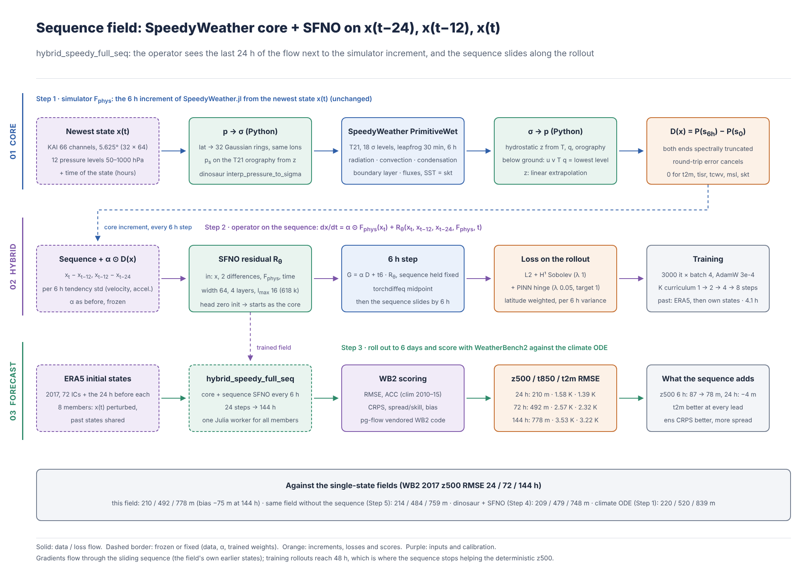

# Step 6: 시퀀스 입력 장 — x(t−24), x(t−12), x(t) + SpeedyWeather + SFNO

## 1. 무엇을 했나

Step 5의 `hybrid_speedy_full`(SpeedyWeather 물리 코어 + SFNO 잔차)은 상태 하나 x(t)만 보고 다음 6 h를 만든다. 여기서는 연산자가 **시퀀스** x(t−24 h), x(t−12 h), x(t)를 보도록 바꿨다.

    dx/dt = alpha ⊙ F_phys(x_t) + R_theta(x_t, x_{t-12}, x_{t-24}, F_phys(x_t), t)



* `FieldConfig.history = [2, 4]`(6 h 스텝 단위 지연). SFNO 입력에 시퀀스의 연속 차분 (x_t − x_{t−12}), (x_{t−12} − x_{t−24})가 6 h 경향 표준편차 단위로 추가된다(66 × 2 채널). x_t 자체도 입력이므로 과거 상태를 그대로 넣는 것과 정보는 같고, 흐름의 관측된 속도와 가속도를 헤드가 쓰는 스케일로 준다.
* 시뮬레이터(SpeedyWeather)는 가장 새 상태 x(t)에서만 돈다. alpha, 손실(L2 + H¹ + PINN), 3000 it, 커리큘럼, 데이터 분할은 Step 5와 같다. 차이는 시퀀스 입력 하나뿐이다(파라미터 601 k → 618 k).
* 롤아웃에서는 시퀀스가 6 h씩 밀린다. 처음에는 과거가 ERA5이고, 12 h 뒤부터 모델 자신의 상태가 들어온다. 학습 때 기울기는 이 밀리는 시퀀스를 통해서도 흐른다.
* 앙상블(IC 섭동 8멤버)은 x(t)만 섭동하고 과거 상태는 멤버가 공유한다.
* 코드: `ffc/field.py`(`history_features`, `rollout(..., past=)`), `ffc/data.py`(`pick_hist`, `gather_past`), `train_field.py --history 2 4`, `predict.py`(1월 초 IC는 전년도 말 상태 사용), `tests/test_step5.py::test_sequence_field_slides_its_history`.

## 2. 결과: WeatherBench2 2017 (72 IC, 같은 3000 it 예산)

z500 RMSE (m), lead별:

| model | 6 h | 12 h | 24 h | 48 h | 72 h | 96 h | 120 h | 144 h |
| --- | --- | --- | --- | --- | --- | --- | --- | --- |
| hybrid_speedy_full (Step 5) | 87 | 138 | 214 | **355** | **484** | **593** | **682** | **759** |
| hybrid_speedy_full_seq | **78** | **129** | **210** | 358 | 492 | 608 | 702 | 778 |

RMSE 24/72/144 h (전체 표: [step6/wb2_tables.md](step6/wb2_tables.md)):

| model | z500 | t850 | t2m | u850 | msl |
| --- | --- | --- | --- | --- | --- |
| climate_ode (Step 1) | 220 / 520 / 839 | 1.67 / 2.71 / 3.79 | 1.58 / 2.69 / 3.74 | 2.59 / 4.33 / 5.71 | 262 / 532 / 774 |
| dinosaur + SFNO (Step 4) | 209 / 479 / 748 | 1.55 / 2.64 / 3.69 | 1.42 / 2.44 / 3.49 | 2.67 / 4.11 / 5.22 | 265 / 522 / 770 |
| hybrid_speedy_full (Step 5) | 214 / 484 / 759 | 1.59 / 2.57 / 3.51 | 1.42 / 2.41 / 3.29 | 2.77 / 4.21 / 5.31 | 270 / 521 / 757 |
| **hybrid_speedy_full_seq** | 210 / 492 / 778 | 1.58 / 2.57 / 3.53 | **1.39 / 2.32 / 3.22** | 2.76 / 4.22 / 5.35 | 265 / 529 / 771 |

8멤버 앙상블:

| ensemble | z500 CRPS 24/72/144 h | t850 CRPS | t2m CRPS | z500 spread/skill |
| --- | --- | --- | --- | --- |
| climate_ode_ens8 | 108 / 248 / **378** | 0.88 / 1.49 / 2.01 | 0.79 / 1.40 / 1.97 | 1.01 / 0.66 / 0.59 |
| hybrid_speedy_full_ens8 | 103 / 248 / 403 | 0.85 / 1.41 / 1.95 | 0.74 / 1.24 / 1.80 | 0.88 / 0.50 / 0.39 |
| **hybrid_speedy_full_seq_ens8** | **101 / 246** / 397 | **0.82 / 1.39 / 1.91** | **0.72 / 1.16 / 1.69** | 1.10 / 0.59 / 0.45 |

2016 검증(8 창) z500 RMSE는 6 h 77 m 대 88 m, 24 h 212 m 대 219 m, 48 h 353 m 대 350 m다. 48 h 강형식 잔차(ERA5 = 1)는 T 0.81 대 0.84, q 0.73 대 0.79로 조금 낮다.

## 3. 해석

1. **시퀀스는 단기 예측을 분명히 개선한다.** z500 RMSE가 6 h에서 −11 %, 12 h에서 −7 %, 24 h에서 −2 %다. 상태 하나로는 알 수 없는 것, 즉 실제 흐름이 지난 24 h 동안 어떻게 움직였는지를 연산자가 받기 때문이다. 코어 초기화 충격(DFI 없음)이나 일주기처럼 한 상태만으로는 위상을 알기 어려운 성분이 여기에 해당한다. t2m는 모든 리드에서 좋아져 144 h 3.22 K로 지금까지의 arm 중 가장 낮다.
2. **48 h 이후 결정론 z500은 나빠진다.** 72 h +1.7 %, 144 h +2.5 %이고, 144 h 편향이 −25 m에서 −75 m로 커졌다. 12 h 뒤부터는 차분 입력이 모델 자신의 상태로 계산되므로, 모델의 오차가 "관측된 경향"으로 되먹임된다. 학습 롤아웃은 48 h까지만 보므로 그 뒤의 누적은 제약되지 않는다. 이득이 사라지는 지점이 정확히 학습 구간의 끝(48 h)이다.
3. **앙상블은 모든 리드에서 좋아졌다.** CRPS가 z500, t850, t2m 모두 시퀀스 없는 arm보다 낮고(t2m 144 h −6 %), t850과 t2m은 climate ODE 앙상블보다도 낫다. spread/skill도 0.39에서 0.45로 올랐다. 다만 해석에 주의가 필요하다. 과거 상태를 멤버가 공유하므로 x(t)의 섭동이 차분 입력에서 "경향의 섭동"으로도 보이고, 이것이 분산을 키운 원인일 수 있다. 과거까지 일관되게 섭동한 앙상블과는 아직 비교하지 않았다.

## 4. 다음 단계 후보

* 학습 롤아웃을 72 h까지 늘리는 커리큘럼(Step 3 방식)으로 48 h 이후의 되먹임을 직접 제약한다. 가장 직접적인 처방이다.
* 차분 입력에 작은 잡음을 넣거나(자기 상태로 만든 과거에 대한 강건성), 지연마다 학습 가능한 게이트를 둔다.
* 과거 상태에도 시뮬레이터를 돌려 F_phys(x_{t−12})와 실제 변화의 차이, 즉 "코어의 최근 오차"를 입력으로 준다. 비용은 코어 호출 2배다.
* 과거까지 섭동한 앙상블, 그리고 Step 2 FM 생성기를 시퀀스 장 위에 붙이기.

## 5. 재현

```bash
export JULIA_DEPOT_PATH=/opt/jdepot
python scripts/train_field.py --kai data/era5_5p625/kai6h --out runs/step6 --cache runs/cache --batch 4 --val-every 250 \
  --n-val 8 --val-K 8 --backbone sfno --width 64 --layers 4 --modes-lat 16 --lambda-sob 1 --sob-s 1 --lambda-p 0.05 \
  --phys-target 1 --core speedy --core-layers 18 --core-dt-min 30 --core-physics all --history 2 4 --iters 3000 \
  --tag hybrid_speedy_full_seq
python scripts/predict.py --kai data/era5_5p625/kai6h --run runs/step6 --tag hybrid_speedy_full_seq --year 2017 --stride 20
```

학습 시간은 CPU 4코어에서 약 4.1 h였다(1600 it에서 컨테이너가 재시작되어 체크포인트에서 이어 학습했고, 재시작 전 1.2 h와 후 2.9 h를 더한 값이다). 가중치와 점수는 공유 폴더 `step6/`에 있다.
